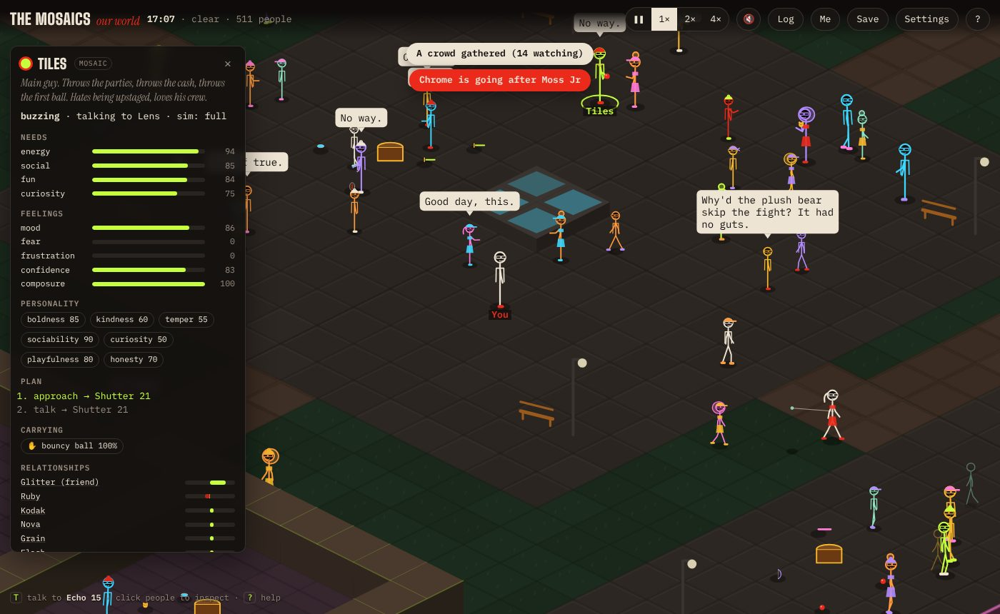
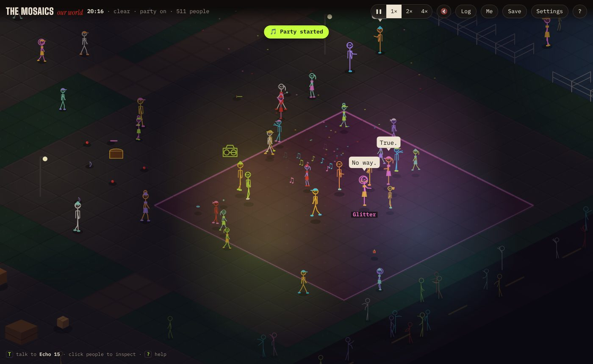

# The Mosaics · Our World

A living, isometric stick-figure parody of central Christchurch hidden inside the MosaicScope website, opened by the "Mosaic World" sign in the footer easter egg. Tiles, Glitter and the rest of the Mosaics live here with about 110 regulars and 300 background locals. Everyone has needs, moods, memories, friendships, grudges and a psychologically modelled mind that learns from experience. Fights, parties, rumours, crimes, romances and routines come out of what people actually see and do.




---

## Quick guide (no coding needed)

**Where is it?** Once the site is live, it's at `https://mosaicscope.pages.dev/world/` (or `yourdomain/world/`). Visitors open it from the "Mosaic World" sign in the footer easter egg.

**Does it slow down the main site?** No. It's a separate page. The main site only gained one link. Nothing from the game loads until someone clicks the sign.

**Do I need to do anything to publish it?** No. The finished game is already built into the `world/` folder, and Cloudflare serves it like any other file. Cloudflare's build settings stay empty.

**Play it on your computer:** double-click `start.command` (Mac) or `start.bat` (Windows), or run `./start.sh`. You need [Node.js](https://nodejs.org) installed once. A browser tab opens with the game.

---

## Controls

| Action | Keyboard / mouse | Touch |
|---|---|---|
| Walk | WASD or arrow keys, or click the ground | Tap the ground |
| Pan / zoom | Drag / mouse wheel (C re-centres on you, +/- zoom) | Drag / pinch |
| Inspect someone | Click them (I inspects yourself) | Tap them |
| Talk | T (nearest or selected person), then 1-9 to answer | "Talk" button |
| Pick up toy | E | "Pick up" |
| Throw | F or right-click (aims at the cursor; hover a person to target them) | "Throw" (at the selected person) |
| Swing foam sword / noodle | Space | "Swing" |
| Drop | Q | |
| Pause / speed | P, or the ❚❚ 1× 2× 4× buttons | Buttons |
| Event log | L (click an entry to see what caused it) | "Log" |
| Developer panel | ` (backtick) | |
| Close panels | Esc | × |

Pick-up, drop, throw and talk keys can be remapped in Settings.

---

## What actually works (v0.1.0)

- **511 simulated people by default**: you, 10 principal Mosaics, 80 mid-ground regulars and 420 background locals. The crowd size is adjustable, and the dev panel can spawn thousands more.
- **Three character tiers that behave differently:**
  - **Principals** (the ten Mosaics) have unique personalities, bios, likes, fears, routines, a GOAP planner, 32-slot memories and full dialogue.
  - **Regulars** use utility AI with template plans, smaller memories and simplified conversation.
  - **Background locals** are batched faded silhouettes with cheap walking. When the camera gets close they're promoted to full AI without losing any state.
- **Dynamic simulation LOD**: full, reduced, group (followers trail their leader), background and sleep levels. Characters involved in events are held at full detail.
- **Toy physics and combat**: balls, frisbees, foam swords, pool noodles, plush bears, shields, foam bows and darts, yo-yos on tethers, jack-in-the-boxes, breakable cardboard boxes, pushable crates, and a craftable plush flail.
  - The physics model covers mass, restitution, friction, spin, sub-stepping against tunnelling, collision layers and masks, durability and breaking, spring pads and shield blocking.
  - Knockback is capped. Physical impact is kept separate from the gameplay effect (stumble, fall, recover).
- **Emergent causal events**: 34 registered event types with priorities, dedupe keys, cooldowns, causal depth limits, backpressure and a per-tick budget.
  - Example chain: a ball aimed at one person hits another. The victim argues with the thrower, the argument draws a crowd, and it may escalate into a toy fight. A friend of whoever gets knocked down jumps in, and a kind bystander helps the victim up.
- **Layered AI**: a hierarchical state machine (physical → panic → conversation → goal), 21 utility-scored goals and a GOAP planner for principals. It handles budgeted A* pathfinding, local avoidance, stuck recovery, replanning and learned toy preferences.
- **Social graph**: sparse per-person edges for familiarity, trust, affection, respect, fear, rivalry, grudge, shared experiences and favours. Friend groups have leaders, reputations shift with what witnesses see, and characters reconcile.
- **Information provenance**: people only talk about what they saw, were told or heard as a rumour, and they say which. Credibility drops with each retelling and with how honest the teller is.
- **Dialogue**: 72 context-conditioned templates (228 lines) with repetition prevention, plus NPC-to-NPC conversations that have consequences (gossip, disputes, apologies, escalating arguments).
  - The player dialogue UI offers up to five things to say, chosen for the moment: who the person is (a barista, a cop, a tourist...), who you are to them (stranger, friend, enemy, partner), what they're doing (eating, skating, busking, partying...), how they feel (scared, angry, hurt, happy) and what's going on (rain, late night, a fight they just saw). Answers unlock follow-ups and nothing is asked twice, so it plays like a real back-and-forth. The classics are still in the mix: news, opinions, brokering peace, gifts, trades, flirting, teasing and toy fights.
  - With an AI brain connected (Settings → Brains: Ollama, Claude, ChatGPT and the rest), a text box appears under the choices on phones and computers: type anything and the person answers in character, from their real mood, job, activity, memories and feelings about you. Insults and kindness you type still count socially. Without a brain it's choices only.
  - Everything is deterministic and works offline. No AI service is used.
- **The world**: a seeded generator builds the Plaza, Park, Court, Market, After Hours Yard, Studio (building interior), Playground, Alley and the Street ring. Connectivity is guaranteed, so decoration never blocks a path.
  - Day and night run at one game hour per real minute. Weather follows a Markov chain (rain sends people to shelter; storms bring lightning and blackouts).
  - Parties at the boombox, lamps and night lighting, and a rare shooting star round it out.
- **Rendering**: Canvas 2D isometric renderer with cached ground chunks and depth sorting. Background figures are batched by colour, there's culling, pooled particles, low-res lighting with lamp holes, rain, speech bubbles and auto quality scaling. Characters are procedural stick figures in the same style as the site's footer crew.
- **Player tools**: an inspector (needs, feelings, personality, live plan, inventory, relationships, memories with sources), a searchable event log with cause chains, speed controls, three save slots, settings and a first-run tutorial.
- **Persistence**: versioned saves (v4+) with migrations. Corrupted or foreign saves fail with a readable message. A pluggable storage provider uses localStorage under the `mosaics-world:` namespace and never touches the main site's keys.
- **Audio**: synthesised spatial sound (impacts by material, whooshes, boings, breaks, rain, party beat). It's off by default, has a volume control, and is rate-limited.
- **Accessibility**: keyboard-only play, touch controls, text scaling, reduced motion (follows the OS; no lightning flashes or fast effects), gentle-fights mode, key remapping, ARIA labels and readable errors when the browser can't run the game.
- **Developer panel**:
  - Metrics: FPS, frame graph, sim timings by system, tick rate, entity counts by tier and LOD, physics bodies and contacts, spatial queries, AI decisions, path queue, event queue, dedupe/drop counts, particles, heap, quality and seed.
  - 11 overlay toggles.
  - Controls to spawn NPCs and toys, trigger events, teleport, and reset with a seed.

---

## Technology & architecture

- **TypeScript (strict) + Vite**, Canvas 2D renderer, custom 2.5D physics, Vitest, and Playwright-core for browser tests. No runtime dependencies at all.
- The simulation (`src/sim`, `ai`, `physics`, `social`, `events`, `dialogue`, `world`, `crowd`, `inventory`) never touches the DOM and runs headless in Node (tests and benchmarks). Rendering only reads simulation state.
- Fixed-step simulation (60 ticks per second at 1×) with an accumulator, interpolated rendering, and a spiral-of-death guard.
- Decisions are recorded in [`docs/adr/`](docs/adr).

```
src/
  app/        Game: loop, input, wiring
  core/       rng (seeded, savable), clock (fixed step), eventBus, config (all budgets), math
  world/      World tiles, WorldGenerator, Navigation (budgeted A*), SpatialHash, iso transforms
  entities/   types + factory
  content/    cast (the ten Mosaics), toys, feature catalogue
  physics/    PhysicsWorld (2.5D toys), combat (impacts, throws, melee), layers
  ai/         brain (HSM), goals (utility), planner (GOAP), steps (primitive behaviours), needs
  social/     relationships, memory, gossip, groups
  dialogue/   DialogueEngine, line templates
  events/     WorldEvents (queue/causality), defs (registry)
  crowd/      LodManager
  sim/        Simulation, Rules (causal wiring), Spawner, Environment (time/weather/power)
  inventory/  pickup/drop/transfer/craft rules
  persistence/ SaveSystem (versioned), storage providers, Settings
  render/     Renderer, Camera, Terrain chunks, StickFigure, ToyArt, Particles, Lighting
  audio/      synthesised spatial audio
  ui/         Inspector, EventLog, DialogueUI, Modals, styles
  debug/      DevPanel, overlay flags
tests/        unit + integration tests (Vitest)
e2e/          smoke.mjs (browser smoke test), bench-render.mjs, shot.mjs
scripts/      bench.ts (headless), catalogue.ts (feature catalogue)
```

---

## Commands

```bash
cd game
npm install          # once
npm start            # dev server, opens http://localhost:5173/world/
npm test             # unit + integration tests
npm run typecheck
npm run build        # type-checks, then writes the playable game to ../world (commit it!)
npm run preview      # serve the built game at http://localhost:4173/world/
npm run smoke        # browser smoke test against the preview server (run preview first)
npm run bench        # headless simulation benchmark (500..10,000 entities)
node e2e/bench-render.mjs   # in-browser FPS benchmark (needs preview running)
npm run catalogue    # regenerate docs/feature-catalogue.json + FEATURE_CATALOGUE.md table
```

**To publish a change:** run `npm run build` and commit both `game/` and `world/`. Cloudflare serves `world/` as-is.

The browser tests use Chromium via `playwright-core`. They look for it at `/opt/pw-browsers/chromium`; set `CHROMIUM=/path/to/chrome` to use another.

---

## Test results (last run)

- `npm test`: **67 passed, 0 failed** across 9 files. Covers coordinate transforms, the fixed-step clock, seeded RNG, the spatial hash vs brute force, world connectivity (4 seeds), navigation, the event queue (priority, dedupe, causal-depth loop protection, backpressure, chains), collision filtering, toy impacts, anti-tunnelling, shields, knockdown and recovery, inventory/ownership invariants, pooling, crafting, relationships, gossip provenance, memory forgetting, dialogue context and knowledge, NPC conversations, the GOAP planner, HSM transitions, personality-dependent reactions, end-to-end pick-up-and-fight, helping, LOD promotion/demotion state preservation, determinism, save/load round trips, v1→v3 migration, corrupted saves, settings, the feature catalogue, and a 4-game-minute integration run.
- `npm run smoke`: **14 passed, 0 failed**. It runs in real Chromium against the production build: tutorial, 500+ people, a non-blank canvas, the clock, keyboard movement, pick up and throw, conversation with choices, inspector via click, event log search, pause and 4× speed, save then load, settings, the dev panel with an overlay toggle, and zero runtime errors.

## Measured performance

Hardware: cloud container, Intel Xeon @ 2.80 GHz, 4 vCPU, no GPU. Node 22. The raw output is in `bench-results/`.

**Simulation only** (`npm run bench`, 1,800 ticks after warm-up, ms per fixed tick; the budget at 60 ticks per second is 16.7 ms):

| Entities | mean ms/tick | p95 | max |
|---|---|---|---|
| 511 | 0.43 | 0.82 | 2.8 |
| 1,011 | 0.52 | 0.84 | 6.2 |
| 2,011 | 1.07 | 2.07 | 5.8 |
| 5,011 | 2.16 | 3.69 | 7.0 |
| 10,011 (stretch) | 5.43 | 8.07 | 16.8 |

**Whole game in the browser** (`e2e/bench-render.mjs`, headless Chromium with **software rendering**, 1280×800, high quality, zoom 1.0, 5-second windows):

| Entities | FPS | renderer CPU ms/frame |
|---|---|---|
| 511 | 59.8 | 2.4 |
| 1,011 | 48.6 | 2.8 |
| 2,011 | 32.5 | 3.9 |
| 5,011 | 23.4 | 6.4 |

Without a GPU, the browser's rasterisation cost dominates. A normal desktop with hardware-accelerated canvas should do noticeably better, but I haven't measured that. Auto quality lowers the resolution, particles and rain when frames run slow.

## Known limitations

- The art is procedural placeholder art drawn in code: stick figures in the site's style, simple iso blocks and toys. It looks deliberate, but it isn't bespoke hand-drawn art. The renderer is structured so art can be swapped without touching the simulation.
- Characters are drawn facing screen-left or screen-right (mirrored), like the site's footer crew. There are no back-facing views.
- Ragdolls are posed knockdowns (lying, stars, recover animation), not simulated ragdoll bodies.
- Interiors: one building (the Studio) with walls, doors and a partition. Walls don't fade when someone is behind them, so walls are kept low for readability.
- Pathfinding is single-level grid A*; there's no hierarchical pathfinding (the world is 64×64).
- Saves cover dynamic state. The in-progress plans of characters are dropped on load and replanned.
- Audio is synthesised blips, not recorded sound.
- No multiplayer. Without a brain connected, dialogue is deterministic templates; a connected brain only picks goals for the Mosaics and voices typed chat.
- Browser numbers above come from software rendering only. GPU-backed and mobile performance hasn't been measured.

See [ROADMAP.md](ROADMAP.md) for what's planned and [FEATURE_CATALOGUE.md](FEATURE_CATALOGUE.md) for the full catalogue.


## Controls (PC and phone)

Move WASD/arrows (phone: the floating stick; push hard to sprint). E uses/enters/gets in a car, T talks, R pickpockets (or holds up a till with a weapon in hand), B bandages, H horns, F throws, Space swings or brakes, M opens the map, V toggles the 2D street view (also the 2D/3D button), ` opens the developer panel. On phones the big button does the most useful thing right now and the ⋯ button holds every other action.

## Graphics quality

Settings → Graphics quality: Auto adapts to your device, Low, Medium, High, **Ultra** (2x-density weathered textures with baked bump lighting, supersampled ground, native resolution, HD figures and a cinematic grade). Auto never selects Ultra.

## Back end (Cloudflare Pages Functions in `/functions/api`)

- `/api/world-stats`: anonymous per-day play-time totals. GET is private: set a `STATS_KEY` variable and send it as `Authorization: Bearer <key>` or `?key=`.
- `/api/chch-map`: OpenStreetMap streets for the full map (© OpenStreetMap contributors, ODbL).
- Both use the optional `EGG` KV binding.

## Dialogue pipeline

Writers produce packs of exchanges (`src/dialogue/packs`); `scripts/merge-dialogue.ts` validates tags and placeholders, drops repeats and over-long lines, and merges everything into `packs/life.ts`.
